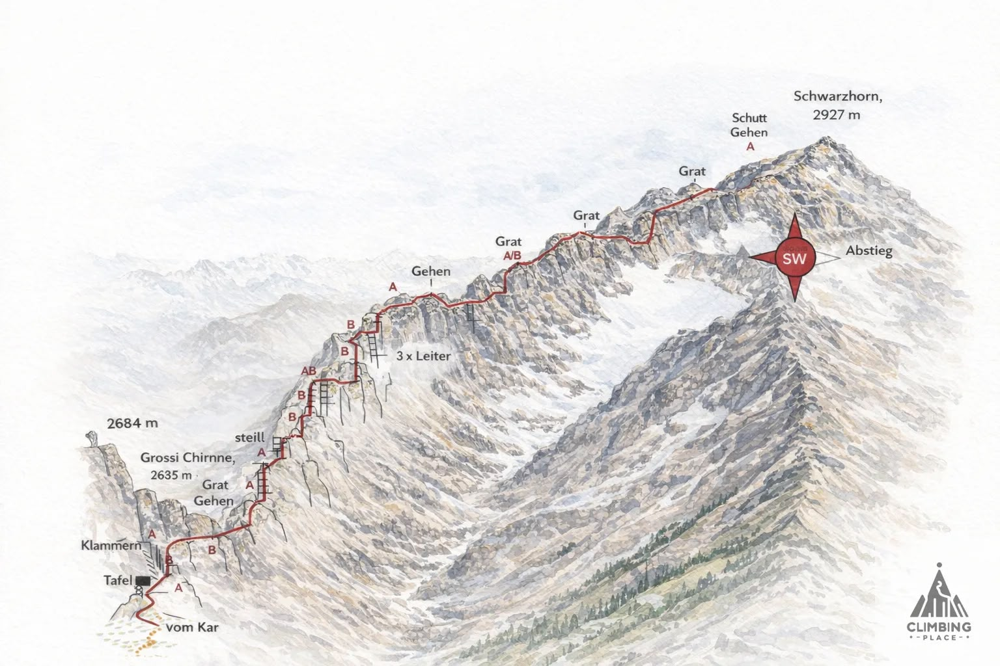







The Schwarzhorn Via Ferrata near Grindelwald is a moderately difficult (K3) alpine climb leading to the 2,928-meter summit of the Schwarzhorn, offering sweeping panoramic views of the Bernese Alps. Overall a very easy Ferrata (more like an Alpine path with some ladders).
Airily staggered aluminum ladders on steep vertical rock faces and an exposed ridge traverse

The route is a strict **one-way trail with no intermediate exits**. It ascends via the southwest ridge, leading climbers up a system of **airy, staggered vertical ladders** and continuous steel security cables. Halfway up the rock bands, a unique mountain resting bench chiseled into the ridge provides a panoramic rest stop before you cross the final knife-edge crest to reach the high summit cross.

 👨‍⚖️
Newcomers [MUST sign the waiver form](https://forms.gle/phYLQZ5mvnNeuR9N9), it contains detailed information about the risks difficulty and more 


 📓 
The [Ferrata Together QuickStart Guide](https://docs.google.com/document/d/19oks3FaopmkEDDOAUF163Lo_qWMmBgFS0Ht5TqTf0YA) is a good start to learn how to execute via ferrata in safety, a must read for beginners and experienced climbers. It contains a lot of tips.


## Weather ☀️
Weather can cancel/abort/shorten the event a few days before if weather is not perfect for execution!  


Source:
 - [MeteoSwiss](https://www.meteoschweiz.admin.ch/lokalprognose/schwarzhorn.html#forecast-tab=detail-view)

## Season 🗓️

Typically accessible daily from **June through October**, strictly depending on seasonal snowpack melt and early autumn winter storms.



## Meeting Point 📍



## Recommended train 🚂: 
To get to the Schwarzhorn via ferrata (above Grindelwald) from Zurich by train, take an SBB train from Zürich HB to Interlaken Ost (via Bern), transfer to the regional train to Grindelwald, take local bus line 121 to the Firstbahn gondola, and ride up to First to begin the hike. Total travel time is around 3.5 to 4 hours one-way.

- Zürich HB to Interlaken Ost: Board the intercity train via Bern or Lucerne. Change trains at Interlaken Ost.
- Interlaken Ost to Grindelwald: Catch the Berner Oberland-Bahn (BOB) regional train directly to Grindelwald station.- Grindelwald to Firstbahn: Walk a short distance from the Grindelwald station to the local bus stop and take Bus 121 (direction: Oberer Gletscher) straight to the Grindelwald Firstbahn stop.
- Gondola to First: Ride the Grindelwald-First Gondola up to the top station at First, which serves as the base for the approach



## By Car 🚗
Drive from Zürich to Grindelwald via Lucerne and the Brünig Pass (approx. 2.5 hours, ~130 km).
Take the A1/A4 out of Zürich, head toward Lucerne, and continue on the A8 over the Brünig Pass toward Interlaken/Grindelwald.Exit: Follow signs through Interlaken to Grindelwald.



## Parking 🅿️

Park explicitly at the paid public parking areas directly adjacent to the **Firstbahn valley lift terminal loop** or at the central Grindelwald village park house.



## Cable car 🚠 

{{< cablecar 
  name="Gondelbahn Grindelwald - First (BGF)" 
  from="Grindelwald Base (1034m)" 
  to="First Mountain Summit (2168m)" 
  duration="25min" 
  distance="5.22km" 
  capacity="6 per cabin" 
  timetable="Summer seasonal service operating daily from 08:30 AM to 05:00 PM with continuous cabin operations." 
  timetable_url="https://jungfrau.ch"
  cost="Approx. CHF 68.- return ticket (GA, Half-Fare, and Jungfrau regional passes yield a 50% discount)" 
  cost_url="https://jungfrau.ch"
  address="Firstbahn AG, Dorfstrasse 187, 3818 Grindelwald"
  phone="+41 (0) 33 828 72 33"
  email="info@jungfrau.ch" >}}


Back and forth ticket 38 CHF with GA or Half Fare, 76 CHF without anything
- 08:00 to 18:00 [timetable](https://www.jungfrau.ch/de-ch/planen-buchen/fahrplan/?to=First)
- https://www.jungfrau.ch/de-ch/grindelwaldfirst
- [Grindelwald-First Gondola](https://grindelwald.swiss/de/map/detail/grindelwald-first-b8e09f4c-b0e7-439b-a1fa-fb0285e72279.html)

## Approach Hike 🏁 




From the First gondola exit, follow the wide gravel trail briefly descending toward Grosse Scheidegg past Distelboden. Turn left onto the marked mountain trail climbing up across the alpine meadows of Chrinnenboden. The path turns narrower and steeper into raw talus scree before winding into the **Grossi Chrinne (2,635m)** to access the rock entry cables.

## Exit hike 🚶🏻‍♂️




From the summit cross, follow the standard normal path dropping down along the narrow, exposed south ridge line. With views of the Bernese peaks and Lake Thun and Lake Brienz.
At the saddle before Gemschberg (2,659m), turn right to descend in sharp switchbacks down the loose, sliding gravel scree field into the basin below. Follow the path back past Chrinneboden to return to the First gondola terminal, or branch left to descend toward Grosse Scheidegg to catch the post bus.
A panoramic trail continues to Grosse Scheidegg, from where the post bus takes us back to Grindelwald. 


## Travelling home 

Gondolas descend continuously from First back to Grindelwald village terminal until 5:00 PM for rapid transit connections back toward Interlaken and Zurich HB.

by public transportation

## WhatsApp group 💬 



## Water 🚰
Completely dry along the high rocky southwest ridge line. Pack a minimum of 1.5L of water to combat high-altitude fluid loss.

Get water or drinks at:
- Berggasthaus First (at the gondola top station terminal)
- Mountain kiosks in Grindelwald village

### Rivers


## WC 🚾 🚽
- Facilities are open inside the First valley station, the First mountain top complex, and the village rail station.

## Alpine lake 🏊
Yes/No

## Renting equipment 🛍️
Full via ferrata security packages can be rented locally down in the main valley center before loading onto the gondolas.



## Donation 💶
Access to the technical installations on the southwest ridge is completely free of charge. The route is meticulously maintained by the local Grindelwald mountain guides association and funded by the regional alpine cable networks.

## Defects ⛓️‍💥

Noticing some broken safety anchors or rockfall cable damage during the climb? Contact immediately:



## Links 🔗
- [sac-cas.ch](https://www.sac-cas.ch/en/huts-and-tours/sac-route-portal/schwarzhoren-schwarzhorn-be-1741/via-ferrata/)
- [outdoor.ch](https://www.outdoor.ch/en/outdoor-mountaineering/via-ferrata-schwarzhorn)
- [ferrataguide.com](https://ferrataguide.com/ferrata/Schwarzhorn-Klettersteig)
- [komoot](https://www.komoot.com/highlight/589532)

## My review ⭐️
A premier, world-class high-altitude ridge adventure! While it relies more on classic high-alpine hiking footwork and mental composure than sheer athletic bicep strength (K2-K3), the exposure is real. Scaling the massive, staggered metal ladders feels like climbing straight into the sky, and standing on the 2,928m summit yields an absolutely jaw-dropping panoramic view over the Eiger, Mönch, Jungfrau, and the deep blue Oberland lakes! Sturdy high-top mountain boots are a must to safely handle the sliding gravel scree on the long south-ridge descent.

## Topography 🗺️ 

## Gallery 🌄 


## Video 🎥



## GPX 🗺️
 


## MAP 🗺️

